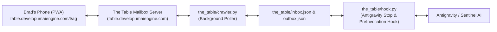

# The Table Mobile Bridge: Phased Native Integration Plan

> **Status**: Shelved / Backlog  
> **Archived Date**: 2026-10-28  
> **Reason**: Mobile hook round-trip needs deeper hardening, and focus is shifting to Mutatum aesthetic redesign (Old-School Ledger Concept).

---

## Overview

The Table Mobile Bridge connects an operator's smartphone via PWA ([table.developumaiengine.com/t/ag](https://table.developumaiengine.com/t/ag)) to Antigravity on the local PC.

This document preserves the 4-phase rollout plan to graduate this bridge into a first-class native capability within DUMEdb and DUME Studio.

---

## Architecture Flow

---

## Phased Implementation Plan

### Phase 1: Native MCP Toolset (`dume.mcp_server`)
1. **`dume_mobile_status`**:
   - Inspects active pairing, token validity, daemon heartbeat, and queue counts.
2. **`dume_mobile_poll`**:
   - Explicit agent-driven polling during normal conversational turns without waiting for the Stop hook.
3. **`dume_mobile_send`**:
   - Standardized tool allowing any model or subagent to post receipts, alerts, or replies directly to the operator's phone.
4. **State Persistence**:
   - Store pairing credentials and session state within `dume/data/memory/` alongside `status_block.md` so it survives restarts.

### Phase 2: DUME Studio Web Interface Integration
1. **The Table Mobile Companion Drawer**:
   - Add a clean, calm expandable drawer in the DUME Studio dashboard (Web 2.0 style, `WF-R9`).
   - Display a generated pairing QR code and one-click copy link for `https://table.developumaiengine.com/t/<token>`.
2. **Daemon Status Indicator & One-Click Toggle**:
   - Surface a live status pill (🟢 `Online` / 🔴 `Offline`) indicating whether the local background poller is active.
   - Start / Stop button triggering the background worker via the local backend.

### Phase 3: Automated Test Suite & CLI Subcommands
1. **Unit & Integration Tests (`tests/test_mobile_bridge.py`)**:
   - Test server handshake, pairing idempotency, queue sweep, outbox delivery, and hook payload injection with mocked server fixtures.
2. **CLI Commands (`dume mobile ...`)**:
   - `dume mobile pair`: Pair and print the mobile URL and QR code in terminal.
   - `dume mobile start`: Launch the background crawler via `pythonw.exe`.
   - `dume mobile stop`: Terminate any running crawler processes.
   - `dume mobile send "..."`: Quick CLI terminal ping to phone.

### Phase 4: Documentation, Tagging & GitHub Release
1. **Architecture Decision Record (ADR)**:
   - Record `ADR-007: Out-of-Band Mobile Telemetry and Stop-Hook Relay`.
2. **README & Customization Guide**:
   - Document how developers can configure `.agents/hooks.json` to keep their agent reachable from any mobile device with zero cloud bloat.
3. **Git Hygiene & Push**:
   - Run linter and full test suite (`pytest tests/`).
   - Atomic commits:
     - `feat(mcp): add dume_mobile native MCP relay tools`
     - `feat(studio): add Mobile Companion panel and QR pairing`
     - `feat(cli): add dume mobile command suite`
   - Push to `main` and draft release tag `v0.4.0`.

---

## Current Local Artifacts
- **Daemon**: `the_table/crawler.py`
- **Hook**: `the_table/hook.py`
- **Client**: `the_table/client.py`
- **Reply CLI**: `the_table/reply.py`
- **Hook Config**: `.agents/hooks.json`
- **Launchers**: `the_table/launch_crawler.bat` (silent `pythonw`), `the_table/stop_crawler.bat`

